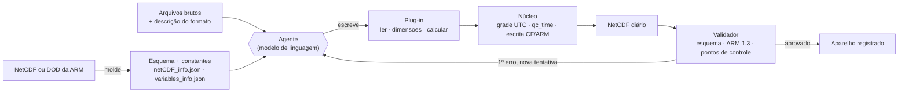

# Geração de NetCDF com agentes

**Do arquivo bruto do instrumento ao NetCDF no padrão ARM/CF, com um agente que escreve o leitor de cada aparelho novo.**

[](https://github.com/Nacpa17/geracao-netcdf-agentes/actions/workflows/testes.yml)

[](https://colab.research.google.com/github/Nacpa17/geracao-netcdf-agentes/blob/main/notebooks/IC_agente_colab.ipynb)

Iniciação Científica · PIBIC INPE/CNPq · dados do ATTO (Amazon Tall Tower Observatory)

> **Da consulta do dado à geração dele.** Nas fases anteriores da IC, um modelo de linguagem aprendeu a consultar os metadados ambientais da ARM ([repositório](https://github.com/Nacpa17/assistente-metadados-ambientais)). Aqui, esses metadados viram o molde para gerar o arquivo do zero: um núcleo comum grava o NetCDF diário a partir do esquema de metadados do grupo, e um agente escreve o código de leitura de um aparelho ou formato novo, corrigindo até o validador aprovar.

**English summary.** This repository turns raw instrument files into daily NetCDF files that follow the ARM Data File Standards 1.3 and the CF conventions. A shared core writes the file from a metadata schema; each instrument contributes a small plug-in; and an LLM agent writes the plug-in for a new instrument or file format, iterating against an automatic validator until the output is correct. The RD-80 impact disdrometer at ATTO is complete and matches the group's existing processing; the Parsivel² optical disdrometer is next.

## Sumário

- [Resultados](#resultados)
- [Como funciona](#como-funciona)
- [Início rápido](#início-rápido)
- [Uso](#uso)
- [Aparelho novo](#aparelho-novo)
- [Estrutura do repositório](#estrutura-do-repositório)
- [Dados](#dados)
- [Próximos passos](#próximos-passos)
- [Referências](#referências)
- [Créditos](#créditos)

## Resultados

Situação em 23/11/2026, com os dados do RD-80 do ATTO-Campina de 15 a 18/12/2024.

| Verificação | Resultado |
|---|---|
| RD-80 × RD80-Processing 3.1 do grupo | 25 das 26 variáveis em comum idênticas em valor, tipo e forma; só `time_bounds` difere, de propósito (relativo a `time:units`, ARM 6.1.4 e CF 7.1) |
| Tempo para os 4 dias | ~1 s (o RD80-Processing 3.1 leva ~30 s) |
| Validador, esquema do grupo | aprovado, nota 100, nos 4 dias |
| Validador, padrão ARM 1.3 | 0 erros; 11 avisos que dependem de decisões do grupo ([próximos passos](#próximos-passos)) |
| Física × fabricante | reproduz os valores impressos no guia do DISDRODATA 2.0 (apêndices 4.4 e 4.5) |
| Parsivel² × arquivos da ARM (`sgpldE13.b1`) | densidade de gotas, conteúdo de água, refletividade e momentos com erro relativo ≤ 2 × 10⁻⁷; parâmetros da exponencial a ~0,2 % |
| Agente com respostas gravadas | 7 de 7 formatos de arquivo, 6 na 1ª tentativa |
| Agente com modelo de verdade | **pendente** |

> **Achado.** Um arquivo com o horário deslocado em 4 h passa na validação dos metadados; só os pontos de controle (valores conhecidos) pegam o erro. Validar o metadado não basta para validar o dado.

## Como funciona



1. **Núcleo**: monta a grade diária em UTC no passo nominal, cria `base_time`, `time_offset`, `time`, `time_bounds` e `qc_time`, e grava o NetCDF com os metadados do esquema, no mesmo formato do `input/support/netCDF_info.json` do RD80-Processing.
2. **Plug-in por aparelho**: só três funções: `ler` (arquivo bruto → tabela), `dimensoes` e `calcular` (a física).
3. **Validador**: confere o esquema, o padrão ARM 1.3, os pontos de controle e, se houver, um gabarito. Nota = 100 − 15 × erros − 3 × avisos.
4. **Agente**: recebe a descrição do formato e de 1 a 3 amostras, escreve o plug-in e recebe de volta o primeiro erro, até passar ou acabarem as tentativas. O código gerado passa por uma checagem estática e roda num subprocesso com tempo limite.

A documentação técnica completa está em [`docs/geracao_netcdf.md`](docs/geracao_netcdf.md).

## Início rápido

### Google Colab

Clique em **Abrir no Colab** (no topo desta página), escolha uma GPU (A100 ou L4) e use **Ambiente de execução → Executar tudo**. O notebook usa a pasta do projeto no seu Google Drive, se houver, ou baixa este repositório; roda os testes, converte os seus dados do RD-80 (se houver uma pasta `dados_rd80/`), confere o circuito do agente e roda o benchmark com um modelo de verdade (padrão: Qwen2.5-Coder-7B).

### Local

```bash
git clone https://github.com/Nacpa17/geracao-netcdf-agentes.git
cd geracao-netcdf-agentes
python -m pip install -e ".[dev]"      # para o agente com modelo local: ".[llm]" e o PyTorch
python -m pytest
```

Rode os comandos a partir da raiz do repositório.

## Uso

```bash
# converter: um NetCDF por dia com dado
python -m geracao_netcdf.gerar --aparelho rd80 --entrada dados_rd80 --saida saida/rd80 --validar
python -m geracao_netcdf.gerar --aparelho rd80 --entrada dados_rd80 --saida saida/rd80 --dia 16/12/2024

# validar no padrão ARM 1.3 (código de saída 1 se houver erro)
python -m geracao_netcdf.validador saida/rd80/*.nc --aparelho rd80 --padrao arm

# molde do esquema de um aparelho novo, a partir de um NetCDF da ARM
python -m geracao_netcdf.molde --de-netcdf exemplo_arm.cdf --saida aparelhos_novos/<nome> \
    --datastream att<sigla>CA.b1 --site att --facility CA --lat -2.1815896 --lon -59.0218639 --alt 59

# agente e benchmark
python -m geracao_netcdf.agente --tarefa aparelhos_novos/<nome>/tarefa.yaml --llm hf:Qwen/Qwen2.5-Coder-7B-Instruct
python -m geracao_netcdf.bench --llm roteiro:benchmarks/geracao/solucoes    # circuito: tem de dar 7/7
```

Modelos aceitos pelo agente (`--llm`): `hf:<modelo>` (local, na GPU), `openai:<modelo>[@url]` (OpenAI e servidores compatíveis, como vLLM e Ollama), `anthropic:<modelo>` (com `ANTHROPIC_API_KEY`) e `roteiro:<pasta>` (respostas gravadas). O código que o modelo escreve é executado: rode o agente num ambiente descartável, como o Colab.

**Equivalência com o `JOSS_gen_netCDF.py` do grupo**

| RD80-Processing 3.1 | Aqui |
|---|---|
| `-s` (todos os dados) | `--entrada <pasta>` |
| `-s -d 16/12/2024` | `--entrada <pasta> --dia 16/12/2024` |
| `-l` (lista em `files.txt`) | `--entrada arq1.txt arq2.txt ...` |
| `-p 16/12/2024` (data no nome do arquivo) | ainda não tem |

## Aparelho novo

1. **Material**: 1 a 3 arquivos brutos, a descrição do formato (separador, decimal, fuso, horário de início ou de fim), o manual com as fórmulas e 2 a 6 valores conhecidos para os pontos de controle.
2. **Molde**: gere o esquema a partir de um NetCDF ou do DOD da ARM do mesmo tipo de aparelho e revise a lista `_revisar`.
3. **Tarefa**: preencha `aparelhos_novos/<nome>/tarefa.yaml` e ponha as amostras em `amostras/`.
4. **Agente**: rode com um modelo local ou por API.
5. **Conferência**: valide com `--padrao arm`, leia o plug-in aprovado e compare a física com o manual.
6. **Registro**: promova o plug-in para `geracao_netcdf/aparelhos/<nome>/`, com `DOCUMENTACAO.md` e um teste.

O Parsivel² do ATTO já tem esquema, constantes e tarefa em [`aparelhos_novos/parsivel2/`](aparelhos_novos/parsivel2/); falta a amostra bruta.

## Estrutura do repositório

```
geracao-netcdf-agentes/
├── geracao_netcdf/               pacote Python
│   ├── gerar.py                  converte arquivos brutos em NetCDF diários
│   ├── esquema.py, grade.py,     núcleo: esquema de metadados, grade de tempo e
│   │   escrita.py                escrita CF/ARM
│   ├── validador.py              esquema, pontos de controle e gabarito
│   ├── padrao_arm.py             regras do ARM Data File Standards 1.3
│   ├── molde.py                  esquema de um aparelho novo a partir da ARM
│   ├── agente.py, llm.py         agente e clientes de modelos de linguagem
│   ├── bench.py, sintetico.py    benchmark: 7 formatos de arquivo com gabarito
│   ├── arm_services.py           cliente dos serviços oficiais da ARM (DOD)
│   └── aparelhos/
│       ├── rd80/                 plug-in, esquema e constantes do RD-80
│       └── parsivel2/            física do Parsivel²
├── aparelhos_novos/parsivel2/    tarefa do agente para o Parsivel² do ATTO
├── benchmarks/geracao/           respostas gravadas do benchmark
├── docs/geracao_netcdf.md        documentação técnica
├── notebooks/IC_agente_colab.ipynb
├── scripts/                      limpeza do esquema do RD-80 e conferência do Parsivel²
├── tests/                        testes automáticos (rodam no GitHub Actions)
├── pyproject.toml
└── CHANGELOG.md
```

## Dados

Os dados brutos e os NetCDFs gerados não entram no repositório (veja o `.gitignore`). Para converter os dados do RD-80, ponha os `.txt` do DISDRODATA em `dados_rd80/`. Os brutos do RD-80 do ATTO-Campina ficam no FTP da USP, conforme o manual de gestão de dados do grupo.

## Próximos passos

- [ ] Rodar o agente com modelos de verdade (ex.: Qwen2.5-Coder 7B × 14B × um modelo por API), nos modos `com_exemplo` e `do_zero`, e montar a tabela comparativa.
- [ ] Parsivel² do ATTO: 1 a 3 arquivos brutos, o formato do logger (separador, fuso, início ou fim do minuto, ordem dos 1024 valores do espectro) e alguns valores conhecidos.
- [ ] Padrão ARM, decisões do grupo: `data_level` "b1" em vez de "ARM b1"; `doi` só o número, com `doi_url`; `title`; QC em inteiro de 32 bits; nome de `qc_number_detected_particles` e prefixo de `qc_calibration`; netCDF-3 ou NETCDF4_CLASSIC.
- [ ] Esquema do RD-80: decidir se a trilha `observation_*` do RD80-Processing 3.1 volta, como variáveis opcionais.
- [ ] Qualidade: detectar o botão TEST do processador (classe 7) e o ruído de vento; avaliar a correção de tempo morto.
- [ ] Seleção de arquivos pela data no nome, como o `-p` do `JOSS_gen_netCDF.py`.

## Referências

- Distromet. *DISDRODATA 2.0 User Guide*, 2009: fórmulas do RD-80 (ap. 4.3) e exemplos de saída (ap. 4.4 e 4.5).
- Distromet. *Disdrometer RD-80 Operating Instructions*, 2015.
- Bartholomew, M. J. *Impact Disdrometer Instrument Handbook*. DOE/SC-ARM-TR-111, 2016.
- ARM Standards Committee. *ARM Data File Standards*, versão 1.3. DOE/SC-ARM-15-004, 2020.
- Zhu, Z.; Wang, D. *Laser Disdrometer (LDIS) Instrument Handbook*. DOE/SC-ARM-TR-137, 2025.
- Wang, D.; Bartholomew, M. J.; Giangrande, S. E.; Hardin, J. C. *Analysis of Three Types of Collocated Disdrometer Measurements at the ARM Southern Great Plains Observatory*. DOE/SC-ARM-TR-275, 2021.
- Tokay, A.; Kruger, A.; Krajewski, W. F. Comparison of drop size distribution measurements by impact and optical disdrometers. *Journal of Applied Meteorology*, v. 40, p. 2083–2097, 2001.
- Serviços oficiais da ARM (DOD em pcm.arm.gov) e a biblioteca [ACT](https://github.com/ARM-DOE/ACT).

## Créditos

| | |
|---|---|
| Bolsista | Eduardo Ribeiro do Amparo Rodrigues de Souza |
| Orientador | Dr. Alan James Peixoto Calheiros (INPE) |
| Coorientador | Prof. Dr. Pedro Luiz Pizzigatti Corrêa (Escola Politécnica da USP) |
| Programa | PIBIC INPE/CNPq |

O esquema de metadados e o RD80-Processing 3.1, usados como referência, são do grupo do ATTO-Campina.
